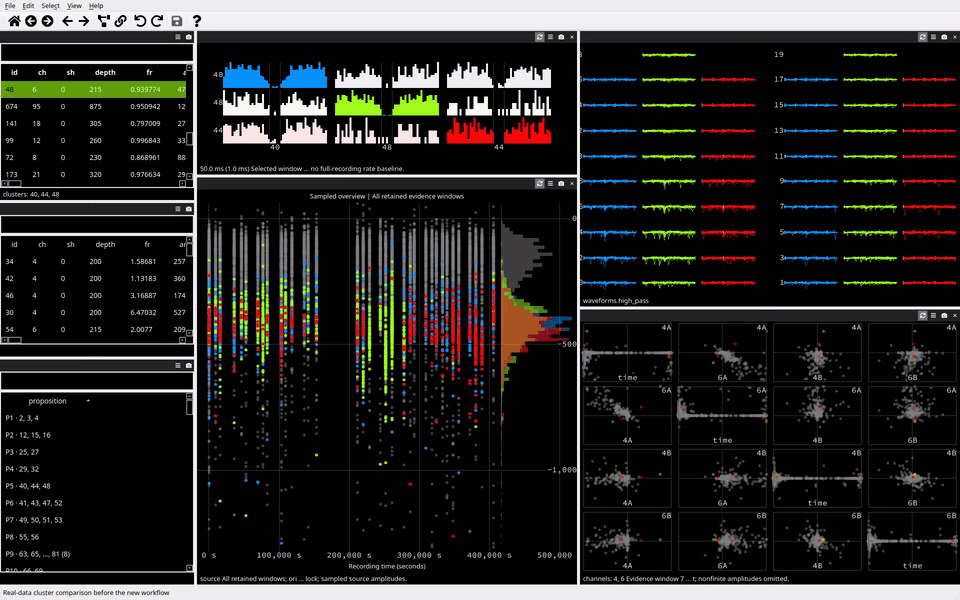

# Carl feedback: rendered real-data validation

## Editable parent restoration — current review

[Play the narrated video on PR #1428](https://github.com/cortex-lab/phy/pull/1428#issuecomment-6946254782).
This review demonstrates the workflow that global Undo and the former read-only
parent view could not provide:

1. Merge the combined SLAY suggestions into unit **705**.
2. Perform two later edits: merge unrelated units into **706**, then mark it **MUA**.
3. Revisit **705** and choose **Restore parents in Merge Mode**. Its exact immediate
   parents become real editable units **707–713**, with original IDs in the **Parent**
   column and preserved colors. The unrelated **706/MUA** edit remains intact.
4. Undo/redo only the restoration. Leave Merge Mode with **V** to show that these
   parents remain live, then stage them again.
5. **Exclude current row** removes **713** from the pending merge; Ctrl-click adds
   candidate **34**. Press **G** to merge the chosen combination into **714**.
6. Save/reopen: **714** remains merged, **713** remains independent, and **706** is
   still MUA. Original SLAY acceptance stays historical, with restored status.

This is a new undoable curation action, not a traversal of earlier Undo entries.
Fresh IDs prevent reuse of retired IDs. New memberships start unclassified rather
than inheriting the former merged unit's quality. **Inspect parents (read-only)**
remains available as the secondary comparison action.

The current recording is 1920×1200, 30 fps, about 58 seconds, with English
narration and burned-in English subtitles. The visible pointer, gold click rings
and translucent keycaps remain; keyboard cues sit above the subtitles. Labeled
**REVIEW NOTE** overlays explain the stages; they are video annotations, not UI.
Interactions retain original speed; idle dwell and the reload wait are omitted,
with a labeled reload card and a [complete edit timeline](restore-review.timeline.json).
It is settled X11 rendering evidence, not a latency or spontaneous-redraw test.
The context menu uses a native XTest right-click; other inputs use Qt events.
No window reaches the user's desktop. The uncut recording and logs stay locally.

Both fresh real-data walkthroughs at `6cf2a4db` passed all **12 checkpoints**, exact
assignment/lineage/color checks, restore Undo/Redo, independent-parent and later-edit
preservation, save/reopen and unchanged source hashes:
[ordinary](restore-ordinary-capture.json) · [bounded](restore-bounded-capture.json).

| Checkpoint | Ordinary | Bounded |
| --- | --- | --- |
| Later unrelated merge and MUA label | [Open](restore-ordinary-06-later-edits.png) | [Open](restore-bounded-06-later-edits.png) |
| Real parents in editable Merge Mode | [Open](restore-ordinary-07-restored-parents.png) | [Open](restore-bounded-07-restored-parents.png) |
| Excluded parent and added candidate | [Open](restore-ordinary-10-new-combination.png) | [Open](restore-bounded-10-new-combination.png) |
| Revised curation reopened | [Open](restore-ordinary-12-reopened.png) | [Open](restore-bounded-12-reopened.png) |

[Full-source restoration report](restore-pipeline-report.md) at `e13906ac` verifies
**all 469,725,567 rows in each of two replays** (one/four workers) against an
independent original-label/raw-amplitude oracle. It exercises a nested merge
following an amplitude split, later unrelated merge/label, restore Undo/Redo,
exclusion/addition/remerge, save/reopen and reprepare. All **45 metadata fields**
(**31,590 cells**) match exactly; original inputs retain their hashes and stats.
[Exact scenario](restore-pipeline-scenario.json) ·
[Final checks](restore-pipeline-final-checks.json) ·
[Artifact provenance](restore-pipeline-artifact-provenance.json).
The later `2ff1b010` runtime change only refreshes bounded review UI immediately;
the new GUI captures and application regression cover it.

Restoration persists across Save/reopen in the same dataset/package. It requires
recorded lineage and refuses a bounded restore if any parent has no retained
evidence. Historical merge restoration after a fresh preparation is unavailable;
already restored live children replay/reprepare normally. Arbitrary bounded
lasso/feature splitting remains outside this change. The converted fixture's
clock/exposure assumptions remain unverified; this is engineering evidence,
not a biological merge-quality or acquisition-timing claim.

Local validation uses the separately proposed **PyQt5-sip 12.20.1** shutdown fix
([PR #1442](https://github.com/cortex-lab/phy/pull/1442)); this feature branch's
lockfile remains unchanged. The core suite passed **692 tests, 13 skipped**, and
the final application suite passed **813 tests, 6 skipped**, both with normal
exit. The application rerun covers the immediate review-status refresh. Lint, format checks,
published documentation checks and source/wheel builds pass. CI is excluded.

Recreate the review cut from a fresh recording with:

```bash
uv run --no-sync python tools/caption_capture_video.py NEW_BOUNDED_OUTPUT \
  --review-cut --review-seconds 58
```

### Narration and reproduction

The synthetic narration was generated locally using [Kyutai TTS](https://huggingface.co/kyutai/tts-1.6b-en_fr)
(CC BY 4.0 model weights, developed by Kyutai) and its published
[voice preset](https://huggingface.co/kyutai/tts-voices/tree/main/unmute-prod-website)
(CC0 for this voice, per the voice repository). Speech dependencies live in a
separate environment and do not change Phy's dependencies.

The reviewed recording uses 11 complete approved sentences, with no internal
speech cuts or tempo changes and at least 0.48 seconds of silence between
sentences. Each placed sentence was verified sample-for-sample against its
approved WAV before whole-track loudness normalization. The AAC audio peaks at
-2.0 dB; the MP4 retains 1,737 video frames at 30 fps and has no full-frame black
interval of at least 0.2 seconds at the documented detection threshold.

[Subtitles](restore-narration.srt) · [Audio placement](restore-narration-alignment.json) ·
[Generation parameters and input hashes](restore-narration-generation.json) ·
[Published artifact verification](restore-review.json).

To reassemble the review from the archived raw capture and approved audio:

```bash
python design/carl-feedback-captures/render-narrated-review.py \
  --capture CAPTURE_DIRECTORY \
  --approved-audio APPROVED_AUDIO_DIRECTORY \
  --output NEW_OUTPUT_DIRECTORY
```

The renderer needs FFmpeg, NumPy and soundfile. The capture directory contains
`walkthrough.mp4`, `review-release-final.ass` and its `.timeline.json`; the approved
audio directory contains `generation.json`, `01-with-bonjour.wav` and
`02-sentence.wav` through `11-sentence.wav`. These original WAVs and raw capture
remain in the local validation archive, rather than adding more media binaries
to Git. The checked-in generation metadata records their hashes. Regenerating
speech is a separate audition step and does not guarantee identical audio.
The renderer refuses to overwrite an existing output directory. Its output was
checked against the approved publication artifact before upload.

The remaining sections preserve earlier evidence and superseded workflows.

## Historical read-only review (superseded)

[Play the updated 30 fps video inline on PR #1428](https://github.com/cortex-lab/phy/pull/1428#issuecomment-6946254782).
The 42.87-second, 1920×1200 recording uses H.264 at 30 fps (about 3.3 MB).
The review cut shows the integrated dark parent workspace, white IDs/counts beside
color swatches, and Back/Esc navigation. New merges preserve their pre-merge colors;
older merges without optional display hints use a deterministic fallback palette.
The recording uses a visible pointer, gold click rings, translucent keycaps over
the lower part of the window, and a nearby Ctrl badge for modified clicks.

The review cut removes idle settling intervals and replaces the blank reload wait
with a labeled **Reload wait omitted** card. Retained interactions play at their
original speed. Its [timeline](integrated-review.timeline.json) records the edits
and maps all ten checkpoints; it is not a latency benchmark. The original uncut
recording and complete logs remain in the separate local validation workspace.
The native GitHub attachment avoids storing another video binary in Git.

Both fresh real-data runs at `3d8b492e` passed assignment, metadata, dirty-state,
undo-history, exact dock-state/action restoration, color preservation, save/reopen
and unchanged-source checks. The ordinary union `[9,15,10,13]` deliberately tests
color continuity across a parent order that differs from numeric ID order.
[Ordinary report](ordinary-integrated-capture.json) ·
[Bounded report](bounded-integrated-capture.json).

| Current parent workspace | Screenshot |
| --- | --- |
| Ordinary, four parents | [Open](ordinary-integrated-parents.png) |
| Bounded, seven parents | [Open](bounded-integrated-parents.png) |

The recorder defaults to 30 fps and uses an isolated Xvfb display. After recording
as described below, create the review cut with:

```bash
uv run --no-sync python tools/caption_capture_video.py NEW_BOUNDED_OUTPUT \
  --review-cut --review-seconds 43
```

The older recordings and screenshots below are preserved as historical evidence;
their detached parent window and footer treatment have been superseded.

The artifacts use actual Qt/OpenGL screenshots and virtual-display recordings,
not generated UI mockups. The earlier videos below are uncut; the current PR
review video is explicitly edited as described above. The ordinary run used Carl's earlier Sway sorting
(4,143,311 spikes, 614 original units, 181,947 stored waveforms). The bounded run
used a fresh package from the converted AIND engineering fixture (469,725,567
source spikes, 705 original units, 93 suggestions), retaining 1,486,361 evidence
spikes and 27,865 stored waveforms under the default 2M-spike / 512MiB caps.
The source fixtures were copied before curation; input-file hashes were
unchanged after each complete run. No windows or recordings reached the desktop.

The converted AIND clock/exposure assumptions remain engineering assumptions;
these captures do not validate acquisition timing, rates or merge quality.
See [the source investigation](../aind-real-data-validation.md).

## Recordings and checkpoints

Scaled 4fps preview; the complete recordings below retain the original frames:



- [Ordinary recording, 51 seconds](ordinary-walkthrough.mp4) · [captions](ordinary-walkthrough.srt)
- [Bounded recording, 54 seconds](bounded-walkthrough.mp4) · [captions](bounded-walkthrough.srt)

The MP4s contain optional English soft subtitles. Video packets are identical to
the original captures; only a subtitle track was added. The display was
1920×1200 at 12fps, Xvfb with software Mesa OpenGL. Renderer inventories and
[packet/dimension checks](artifact-validation.json) accompany the videos.
The recorder limits BLAS and software-renderer threads within its own process.
These videos are visual/state evidence, not interactive latency benchmarks.

Each run exercised ten checkpoints: initial comparison, actual correlogram
right-click transfer, one suggestion, Ctrl-click addition/removal, explicit G
merge, context-menu Show parents, visible one-click return, undo, redo/save,
and reopen. Qt mouse/key events drive native widgets; this does not establish
physical input routing. Screenshot settlement pumps events and resizes the GUI,
so this does not prove spontaneous repaint correctness.

The bounded run explicitly chooses evidence window 7 to show the selected units'
stored waveforms/features. Reopening initially selects window 0; the final
recording explicitly uses the **Inspect evidence window** dialog to select 7
again. This is a user action, not automatic persistence of the inspected window.
The final amplitude plot consequently shows that window rather than the initial
all-windows overview.

| Checkpoint | Ordinary | Bounded |
| --- | --- | --- |
| Ctrl-click combined suggestions | [Screenshot](ordinary-04-control-click-union.png) | [Screenshot](bounded-04-control-click-union.png) |
| Exact immediate parents | [Screenshot](ordinary-06-show-parents.png) | [Screenshot](bounded-06-show-parents.png) |
| Saved state reopened | [Screenshot](ordinary-10-reopened.png) | [Screenshot](bounded-10-reopened.png) |
| Correlogram row transferred | In video | [Screenshot](bounded-02-right-click-transfer.png) |
| Undo restores both suggestions | In video | [Screenshot](bounded-08-undo.png) |

The ordinary union was `[9,15,10,13] → 614`; the bounded union was
`[40,44,48,49,50,51,53] → 705`. Selection alone changed neither assignments nor
reviews. Both selected reviews were accepted-modified by the explicit combined
merge. Parent inspection changed no assignments, metadata, dirty state or history.
Undo restored assignments, review records and the exact proposition workspace;
redo and save/reopen preserved the complete expected assignment vector and both
review records. All returned parent groups were exact after reopening.

The images revealed two real UI defects that state-only tests missed: the generic
GUI toolbar started hidden, and a wrapped label could consume excessive header
height. Commits `f2102295` and `4a2345b2` fix visible/reachable return controls,
a compact untruncated legend, and a 2×2 scientific layout with correlogram priority.
Regression coverage checks visibility, actual click geometry and wrapping for
2, 7 and 16 parents at two window widths.

The ordinary capture is at `40c5d2bd`; the final bounded capture is at
`ce019119`. Only the recorder's explicit reopen-window step differs between
those revisions; production runtime files are identical. Sanitized checkpoint
reports: [ordinary](ordinary-capture.json), [bounded](bounded-capture.json).
All twenty original PNGs and complete local logs remain in the separate validation
workspace; selected checkpoints are published here with both complete recordings.

## Full-source replay and performance

[The pipeline report](pipeline-report.md) covers independently verified assignments
for every one of the 469,725,567 source rows in **both** serial and four-worker
replays, following a combined SLAY merge and source-amplitude split. It also
covers byte-identical prepared/store/index payloads, all 140,240 waveform rows,
save/reopen, repreparation, exact counts, finite-amplitude counts and sums, labels,
review records, independent source inventories and output inode separation.

[The matched baseline comparison](baseline-comparison.md) uses identical dependencies,
parameters and checkpoint with unmodified `3ee67e5` versus `40c5d2bd`:

| Serial operation | Old PR head | Current | Observed result |
| --- | ---: | ---: | --- |
| Preparation | 88.42 s | 33.49 s | 2.64× faster |
| Full replay | 54.93 s | 54.99 s | Essentially unchanged |

The separate one-versus-four-worker run found preparation 31.75 → 26.92s,
row snapshots 61.97 → 59.18s, indexes 67.46 → 102.65s, and replay 53.86 → 52.51s.
These are single warm-cache workstation observations with possible concurrent
validation work, not controlled causal estimates or predictions for Carl's newer
5.24-billion-spike recording. The default stays at one worker; more workers can
slow index construction on this layout.

## Reproduction

From a synced checkout, using the existing real fixture paths on your machine:

```bash
uv run --no-sync python tools/capture_carl_feedback.py \
  --mode ordinary --dataset SWAY_SOURCE --output NEW_ORDINARY_OUTPUT
uv run --no-sync python tools/capture_carl_feedback.py \
  --mode bounded --dataset FRESH_BOUNDED_PACKAGE --output NEW_BOUNDED_OUTPUT
```

The recorder creates its own Xvfb server, configuration and copied dataset.
It needs Xvfb, GLX/Mesa, glxinfo and FFmpeg. Its bounded example expects the
specific AIND proposition groups named above. New output directories are required.
It mutates only its newly created working copy and checks source hashes afterward.

A standalone verifier independently rechecked both full replay assignment arrays
without importing Phy's projection or journal implementation:

```bash
uv run --no-sync python tools/verify_feedback_replay.py \
  --source CONVERTED_SOURCE --outputs REPLAY_ONE REPLAY_FOUR \
  --parents 40 44 48 49 50 51 53 --children 706 707 \
  --threshold -378.4182434082031
```

It verified all rows, 700 active units, and child counts 1,691,273 / 1,597,610.

## Historical local checks and test-process limitation

The final application target passed **795 tests, 6 skipped**, with exit status zero.
Both final real GUI recording processes exited normally. All **15 focused parent
regressions** pass, including a canceled dirty-close prompt, blocked editing keys,
Back/Esc, exact layout/action/focus restoration, failure cleanup, saved color hints,
and historical fallback. Lint, formatting, documentation generation/checks and
source/wheel builds pass; the wheel includes the new workspace module.

The core partition passed **682 tests, 13 skipped**, then the previously documented
intermittent native interpreter-shutdown fault recurred (exit 139, no Python frame).
Thus `make test-full` did **not** complete cleanly; the application target was run
separately. CI is excluded at the maintainer's request. Prior standard and debugger
core runs have exited normally; the cause remains unlocalized. This supports
further beta testing, not a claim that native shutdown is fixed or release
readiness is established.
