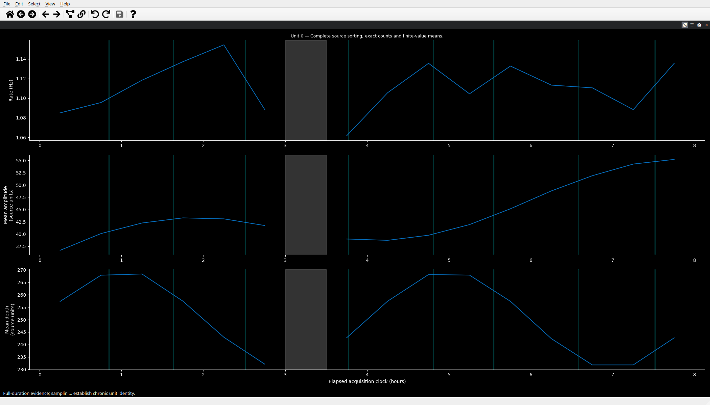
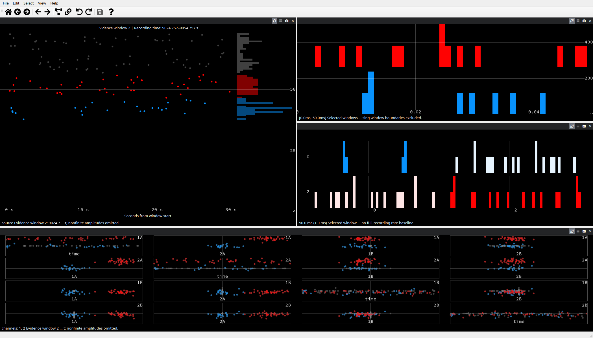

# Curating long recordings

Phy's long-recording workflow prepares a bounded evidence dataset for interactive
review, then replays supported curation actions against the complete local
sorting. Preparation reads source arrays in batches; it does not load the full
sorting into the GUI. The source dataset is retained unchanged, and replay
writes a separate output dataset.

This workflow is intended for a Phy sorting with one fixed-rate, monotonic sample
clock. Multi-segment recordings are not supported. Supply acquisition duration
and valid acquisition intervals when they are not already recorded in the
dataset metadata. Duration describes exposure; Phy cannot infer acquisition
gaps from periods with no spikes. Intervals use half-open sample coordinates
`[start, end)`.

The screenshots below show the actual bounded GUI views using a deterministic
synthetic eight-hour sorting. The overview plots full-duration rates and
available source means; gray marks the synthetic acquisition gap and cyan marks
the retained evidence windows. The evidence view places windowed amplitudes at
top left, sampled ISI at top right, sampled correlograms at middle right, and
features below. They illustrate the interface and its sampling context; they
are not biological data or scientific examples.





Recreate these images from source with Qt's X11 platform and software OpenGL
(the script writes a temporary synthetic source and bounded package):

```bash
QT_QPA_PLATFORM=xcb LIBGL_ALWAYS_SOFTWARE=1 \
  xvfb-run -a -s '-screen 0 2400x1600x24 +extension GLX' \
  uv run python tools/capture_long_recording_views.py
```

## Prepare bounded evidence

Run `prepare-large` with the source `params.py` and a new output directory:

```bash
phy prepare-large /data/recording/params.py /data/recording-bounded \
  --duration 3600000 \
  --valid-intervals /data/recording/valid-intervals.npy \
  --max-spikes 2000000 \
  --max-bytes 536870912 \
  --window-seconds 30 \
  --stratum-seconds 3600 \
  --seed 0 \
  --bin-seconds 3600 \
  --batch-size 100000
```

`--duration` is in seconds and must agree with declared acquisition metadata.
The `.npy` valid-interval file contains an integer array of shape `[W, 2]` with
ordered, nonoverlapping sample pairs.
Without it, the full declared duration is treated as valid exposure. Do not use
that default when the recording contains acquisition gaps.

`--max-bytes` limits the bounded output package size, including its summaries and
window plan. It is not a process-memory or peak-RSS limit. The source unit IDs
must fit nonnegative `int32`; sample coordinates and full-source spike row IDs
use `int64`.

Preparation chooses shared time windows under the spike and byte budgets. The
window length, strata, and seed make the plan reproducible; inspect the saved
window plan in the output package when documenting or repeating an analysis.
Windows that exceed the budget are omitted, so a high-density interval can
reduce retained evidence. Preparation does not shorten an over-budget window or
silently thin spikes inside it. A survey of shared windows is supplemented by
deterministic rescue evidence for units missed by the survey. This improves the
chance of seeing rare units, but makes the evidence selection unequal: rescue
windows must not be treated as a probability sample.

Preparation records exact full-recording spike counts and rates using valid
acquisition exposure. If source scalar amplitudes or depths are available, it
also records per-bin finite-value means and availability counts. It does not
invent missing measurements or convert source values to physical units. Stored
waveforms are included only where available in the source; raw traces are not
required when stored waveform data are sufficient for the views being used.
Producer-supplied per-unit metrics and annotations remain inherited metadata;
Phy does not recalculate those values for merged or split units. Use the
full-count, rate, amplitude-mean, and depth-mean summaries produced by this
workflow for the measurements they explicitly cover.

## Review and curate

Open the bounded output with the normal GUI command:

```bash
phy template-gui /data/recording-bounded/params.py
```

The bounded manifest explicitly selects this mode. Bounded mode has its own
configuration namespace and default view layout; it does not replace the normal
Phy layout or restore ordinary saved dock geometry. The GUI keeps full-recording
counts and rates distinct from counts in selected evidence rows. Unit Stability
shows time-binned counts/rates, available source scalar-amplitude means,
evidence windows, and acquisition gaps. Missing measurements and units without
evidence remain visible as unavailable.

Evidence Amplitude shows raw source scalar amplitudes from the currently
selected evidence window. The Feature view also uses window-relative seconds.
The amplitude plot labels this axis as **Seconds from window start** and shows
the window's recording-time range above the plot.
Both views label the current window and reset their time origin when it changes.
To inspect another retained window, choose **View > Inspect evidence window**
and enter its zero-based index. Unit Stability keeps the full-recording time
context visible while you inspect individual windows.

The Sampled ISI view excludes intervals crossing retained-window boundaries.
The Sampled Correlogram view shows raw pair counts from retained windows; it
does not apply a full-recording rate baseline. Both views are explicitly labeled
as sampled evidence. Its central bin counts unordered within-unit pairs and
combines both temporal orientations for cross-unit pairs whose absolute delay
is less than one bin, so tied sample times do not depend on source row order.
For exact pair counts, each unit may have at most 46,340 spikes in an evidence
window; the view reports an error for a larger per-unit window. Prepare shorter
windows if this limit is reached.

Bounded curation supports whole-unit merges, cluster labels, and a source
amplitude threshold action. Use the GUI action **Split by source amplitude**
with one unit selected and a threshold in the source amplitude units. The action
uses the source `amplitudes.npy` scalar for every spike during replay; nonfinite
values stay with the remainder. Child units show full-data metrics as pending
until the replayed sorting is re-prepared, because their complete counts and
trends have not yet been calculated. Merge and label actions are journaled with
the bounded assignments and metadata in an atomic checkpoint generation.
Reopening loads the last complete generation. A reopened session starts a new
undo baseline. Each save checks that the checkpoint has not changed since this
session opened. If another session has saved first, the stale save fails; reopen
the bounded dataset before continuing to avoid overwriting that generation.

Lasso, feature, and waveform splits remain unavailable in bounded mode because
the selected rows do not define how unseen source spikes should be assigned.
Standard, unbounded datasets retain their existing curation behavior.

## Unit Stability on ordinary recordings

Unit Stability can also be opened as an optional view for an ordinary dataset.
It evaluates only the selected unit and bins its loaded spikes over the recording
duration. Since ordinary datasets do not supply valid acquisition intervals to
this view, its rate assumes continuous acquisition; the plot labels that
assumption. The ordinary default view layout remains unchanged. Use the bounded
manifest workflow above when known acquisition gaps must be represented
explicitly.

## Apply to the complete sorting

After saving the bounded session, replay its journal against the exact source
assignment revision used during preparation:

```bash
phy apply-curation /data/recording/params.py /data/recording-bounded \
  /data/recording-curated --batch-size 100000
```

Replay checks the source identity and parent assignment revision, streams the
complete assignment array in batches, and writes a new full sorting. It rejects
a journal prepared from a different source revision. Keep the original source
and bounded package; they establish the lineage of the curated output. To review
the curated full sorting with bounded evidence again, run `prepare-large` on
the curated output to produce a fresh package and revision-specific summaries.
This replay and re-preparation step also resolves full-data counts and trends
for threshold-split children.

## Interpreting evidence

Full counts and exposure-based rates describe the complete sorting. Window plots,
waveforms, feature scatterplots, and other bounded measurements describe only
the retained evidence. Survey and rescue selection can overrepresent some
periods or units, and waveform availability can vary across units and time.
These views do not establish full-recording quality, contamination, refractory
violations, or continuous biological identity. Use them to guide review, not as
scientific claims about unseen spikes. Long-duration coordinates preserve the
source sample clock; silence alone is never evidence that the acquisition was
inactive.

For reproducible synthetic capacity measurements, run
`uv run python tools/benchmark_long_recording.py`. The benchmark reports
preparation and replay time and peak memory in separate processes and checks
replay against a streamed oracle. It is capped at two million synthetic spikes;
its results are not a substitute for measurements on real chronic datasets.
