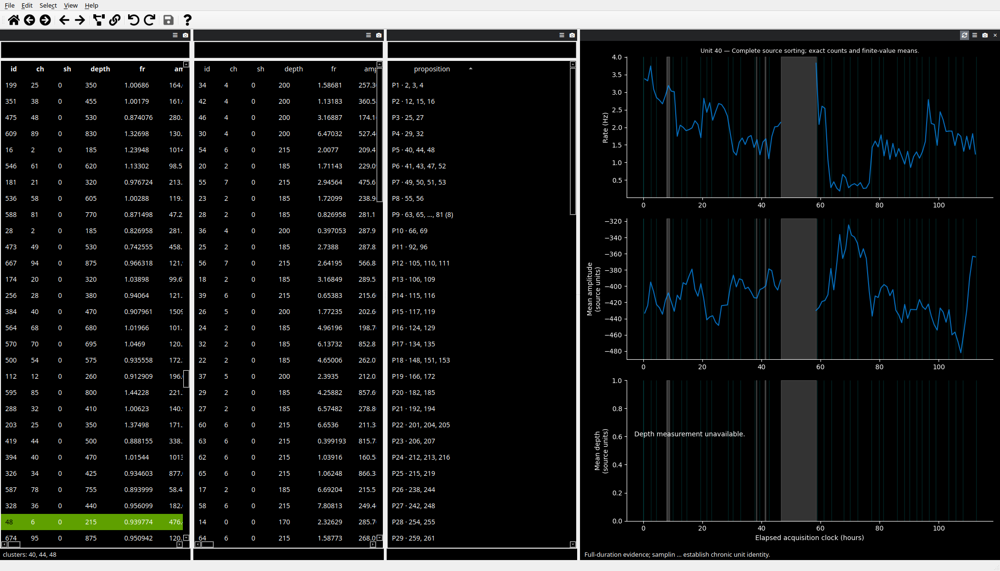
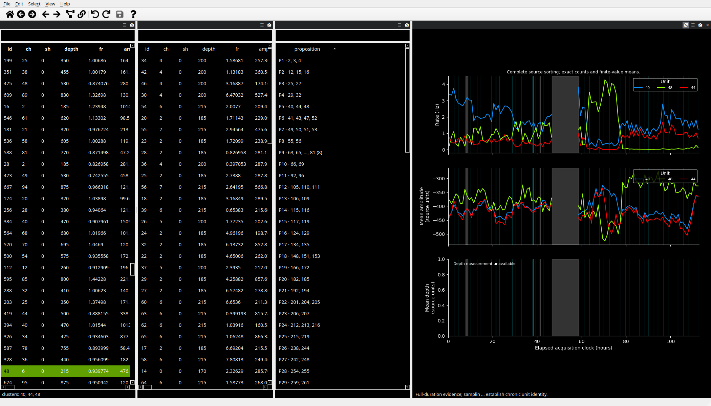
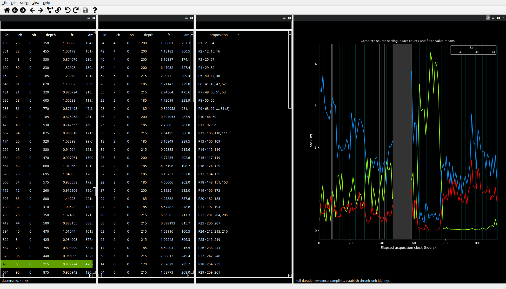
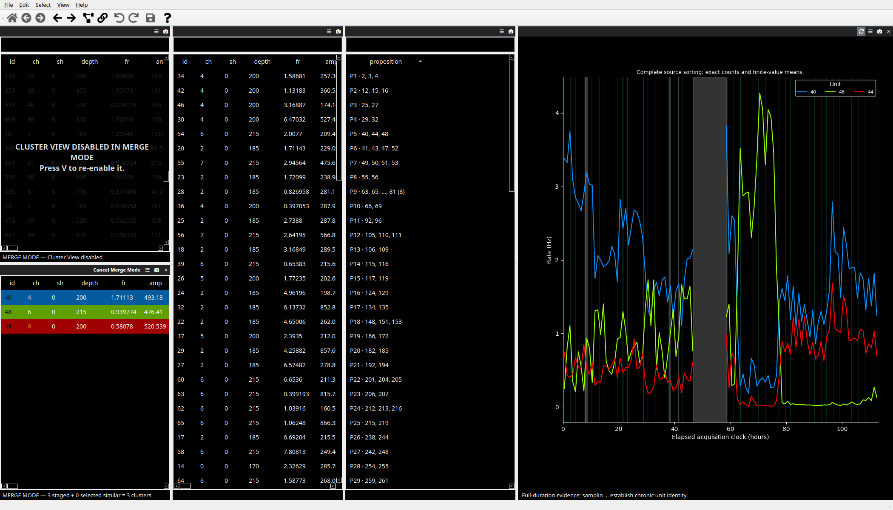
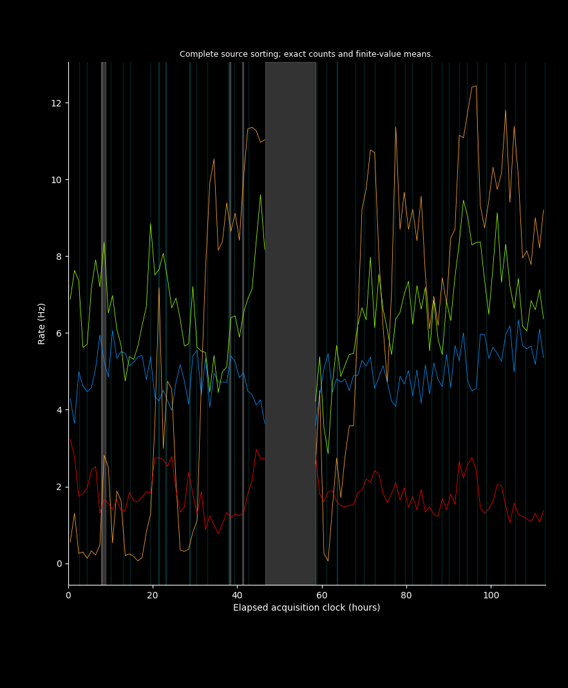
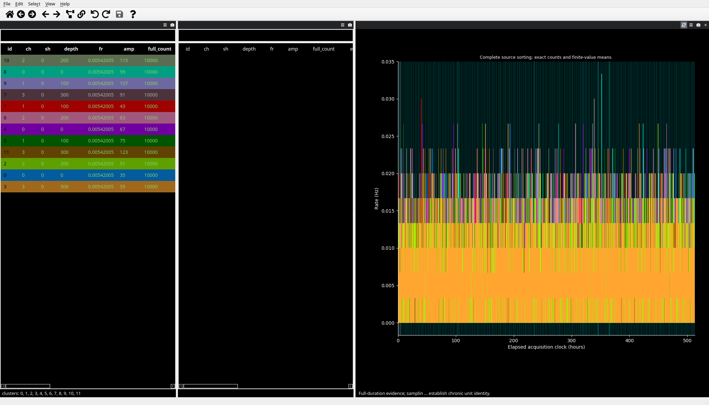
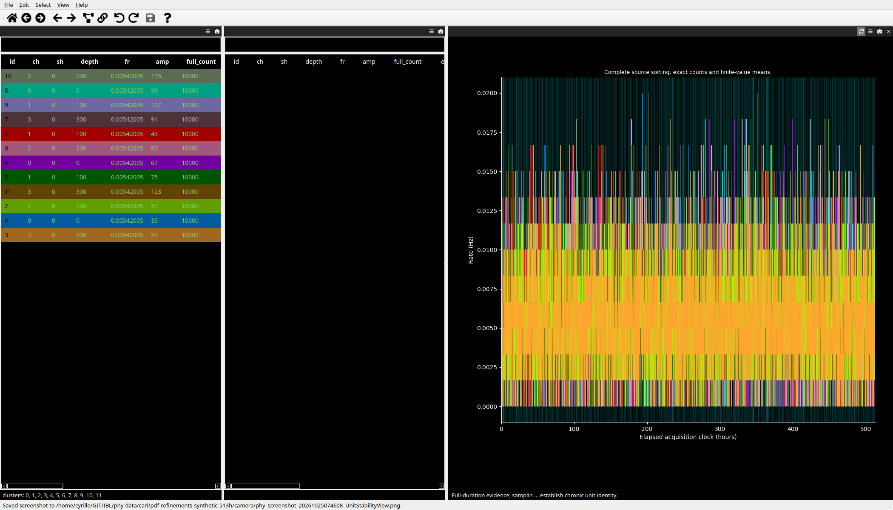
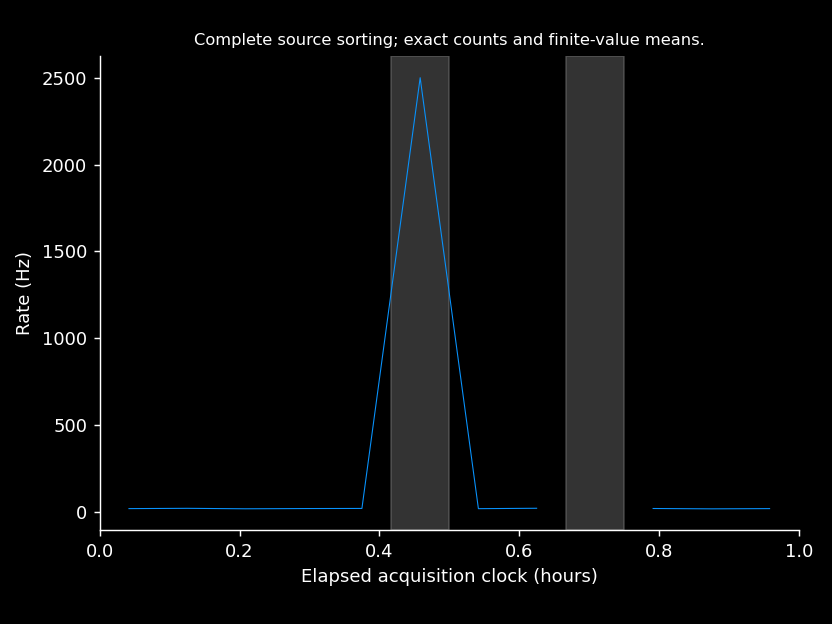
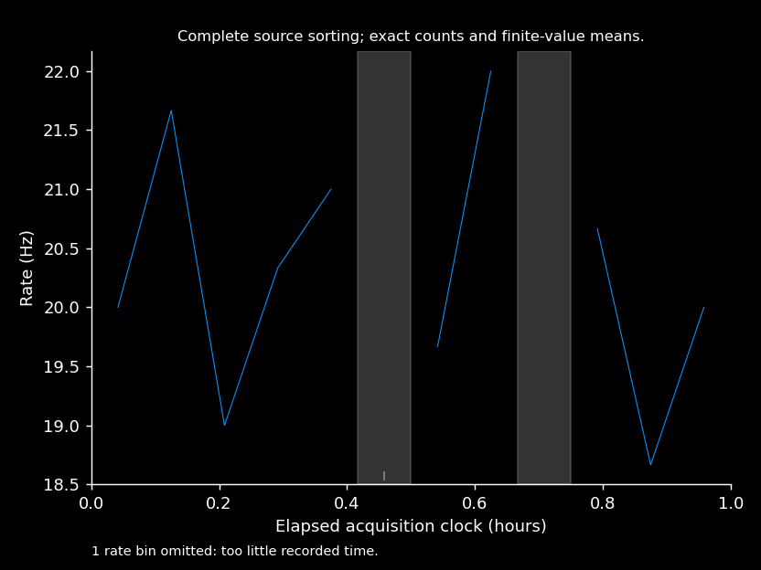

# Curating long recordings

Phy's long-recording workflow prepares a bounded evidence dataset for interactive
review, then replays supported curation actions against the complete local
sorting. Preparation reads source arrays in batches; it does not load the full
sorting into the GUI. The source dataset is retained unchanged, and replay
writes a separate output dataset.

This workflow supports a single monotonic event axis. Existing sources without
an explicit time-base declaration use `acquisition_samples`, the legacy
fixed-rate sample-coordinate contract. Sources with `time_base` may instead
declare `elapsed_ticks`: nonnegative integer elapsed-time coordinates with a
declared `ticks_per_second`. In either case, `num_samples` is the exclusive
upper bound of the canonical coordinate axis, and `valid_intervals` are
half-open `[start, end)` intervals on that same axis. For elapsed ticks,
`num_samples` is a tick bound, not a physical frame count. Explicit elapsed
sources must provide authoritative valid intervals; Phy cannot infer
acquisition gaps or filler from periods with no spikes. Multi-segment recordings
are not supported.

The `time_base` declaration is a dictionary such as
`{'kind': 'elapsed_ticks', 'ticks_per_second': 30000.0}` in `params.py` (or
`recording.time_base` in the waveform manifest). For this workflow,
`ticks_per_second`, `sample_rate`, and the physical waveform sample rate must
be equal. Unequal event and waveform rates need separate waveform-axis support.
A source containing `timestamps.json` must declare its coordinate contract
explicitly; Phy does not parse that file to guess a conversion. Elapsed ticks
cannot index raw voltage, so an elapsed source with a real `dat_path` is not
supported. Stored waveforms can be used without raw data.

For explicit elapsed exports, the waveform manifest must declare
`recording.sample_index_coordinates` and
`recording.window_bounds_coordinates` as `elapsed_ticks` when those sidecars are
present. The waveform-aligned `sample_index[w]` must equal
`spike_times[subset_spikes[w]]`; it is neither a source row ID nor a raw frame
offset. The manifest's `sample_index_coordinates` and
`window_bounds_coordinates` must each equal the declared `time_base.kind`.
Producer window bounds describe canonical elapsed coordinates and must not
cross unsupported gaps. The 512 MiB output cap applies to package bytes, not
process RSS; waveform source, retained, and omitted counts are reported in the
CLI and manifest.

The screenshots below show the bounded GUI views using a deterministic
synthetic eight-hour sorting. These captures document the interface before
the latest Unit Stability display refinements; their unit cap and legend are
historical. The overview plots full-duration rates and
available source means; gray marks the synthetic acquisition gap and cyan marks
the retained evidence windows. The evidence view places windowed amplitudes at
top left, sampled ISI at top right, sampled correlograms at middle right, and
features below. They illustrate the interface and its sampling context; they
are not biological data or scientific examples.


Recreate these images from source with Qt's X11 platform and software OpenGL
(the script writes a temporary synthetic source and bounded package):

```bash
QT_QPA_PLATFORM=xcb LIBGL_ALWAYS_SOFTWARE=1 \
  xvfb-run -a -s '-screen 0 2400x1600x24 +extension GLX' \
  uv run python tools/capture_long_recording_views.py
```

### Comparing clusters on a real recording

These actual Qt captures use the same converted AIND test export, selected
clusters **40, 44, and 48**, 113 summary bins, and 2100 × 1200 window size.
The elapsed clock spans 112.9 hours including declared gaps. Rate and source
amplitude are available; depth trends are unavailable. The exposure mask is
the test conversion's declaration, not independent acquisition verification.

| Before: only unit 40 displayed | After: all three selected units |
| --- | --- |
|  |  |

Turning off **Show amplitude** and **Show depth** expands the rate comparison:



These captures predate the current Unit Stability display refinements; the
overlaid rates remain representative, while any legend or unit-display limit
visible in them is historical. The same colors and cluster IDs follow the staged
Merge candidates:



To capture an existing package, use a fresh output directory outside it. The
script opens a temporary copy and verifies the input file hashes are unchanged:

```bash
QT_QPA_PLATFORM=xcb LIBGL_ALWAYS_SOFTWARE=1 \
  xvfb-run -a -s '-screen 0 2400x1600x24 +extension GLX' \
  uv run python tools/capture_long_recording_views.py --comparison \
  --bounded-dir /data/recording-bounded --cluster-ids 40 44 48 \
  --dataset-label 'Recording test export' --output-dir /tmp/stability-captures
```

A separate [synthetic 500-hour example](images/unit-stability-comparison/synthetic-500h-overview.png)
exercises rate, amplitude, and depth together over 1000 bins. It is generated
test data, not Carl's 500-hour recording. Reproduce it with `--comparison
--synthetic-hours 500 --output-dir /tmp/stability-500h` instead of `--bounded-dir`
and `--cluster-ids`.

### Latest display refinements

The following captures show the current controls on Carl's earlier converted
112.9-hour test export, with units **24, 26, 27, and 32**. The camera image was
saved through Unit Stability's own screenshot action. Legends are removed and
native rate lines use the new 0.6-point default. Declared exposure remains the
conversion's test mask, not independent acquisition verification.



A separate generated 513-hour fixture displays twelve selected units with
6156 native five-minute bins. Selecting ten-minute display bins groups these
into 3078 bins by adding counts/exposure and measurement sums/counts; prepared
files remain unchanged. This is generated test data, not Carl's 500-hour export.

| Native five-minute bins | Ten-minute display bins |
| --- | --- |
|  |  |

Reproduce the generated stress captures with `--comparison --synthetic-hours
513 --synthetic-units 12 --summary-bin-seconds 300 --output-dir
/tmp/stability-513h`. The capture script also exercises the view's camera action
and writes `camera-rate-only.png`. Display coarsening starts at the native
prepared resolution; it never changes preparation's default bin size.

## Prepare bounded evidence

Run `prepare-large` with the source `params.py` and a new output directory:

```bash
phy prepare-large /data/recording/params.py /data/recording-bounded \
  --duration 3600000 \
  --valid-intervals /data/recording/valid-intervals.npy \
  --max-spikes 2000000 \
  --max-bytes 536870912 \
  --window-seconds 30 \
  --stratum-seconds 3600 \
  --seed 0 \
  --bin-seconds 3600 \
  --batch-size 100000
```

`--duration` is in seconds and must agree with declared acquisition metadata.
The `.npy` valid-interval file contains an integer array of shape `[W, 2]` with
ordered, nonoverlapping coordinate pairs. Without it, legacy acquisition-sample
sources treat the full declared extent as valid exposure. Explicit elapsed
sources require authoritative `valid_intervals` in metadata or supplied
explicitly through the CLI/API; there is no full-extent
default for them.

`--max-bytes` limits the bounded output package size, including its summaries and
window plan. It is not a process-memory or peak-RSS limit. The source unit IDs
must fit nonnegative `int32`; sample coordinates and full-source spike row IDs
use `int64`.

Preparation uses `--window-policy auto` by default. When validated producer
windows are available, it selects among those whole windows and preserves their
acquisition boundaries. Producer-window mode requires valid producer windows;
it does not generate rescue windows to compensate for missing or malformed
producer evidence. Without producer windows, the original shared-window planner
uses the configured window length, strata, and seed. Inspect the saved window
plan in the output package when documenting or repeating an analysis.
Windows that exceed the budget are omitted, so a high-density interval can
reduce retained evidence. Preparation does not shorten an over-budget window or
silently thin spikes inside it. The generated planner supplements its survey of
shared windows with deterministic rescue evidence for units missed by the
survey. This improves the chance of seeing rare units, but makes the evidence
selection unequal: rescue windows must not be treated as a probability sample.
The explicit `producer` policy uses only producer windows. The `auto` policy
can supplement producer windows with generated rescue evidence for units still
missing from the selected evidence.

Overlapping producer windows are allowed; selection uses their union while
retaining their acquisition boundaries. Preparation records exact
full-recording spike counts and rates using valid exposure. If source scalar
amplitudes or depths are available, it
also records per-bin finite-value means and availability counts. It does not
invent missing measurements or convert source values to physical units. Stored
waveforms are included only where available in the source; raw traces are not
required when stored waveform data are sufficient for the views being used.
The default spike and byte budgets remain 2,000,000 spikes and 512 MiB. Output
byte budgets describe package bytes, not resident memory. Waveform availability
can exceed the bounded output budget: preparation reports waveform counts
retained, omitted, and available in the source on the CLI, and stores the counts
in the manifest so truncation is visible.
Producer metadata tables retain their source filenames, delimiters, and column
order, including multi-column CSV files. For a new merge or split membership,
producer values and source-unit IDs are blank; imported custom fields are also
cleared. Quality labels belong to the current unit
membership: a new membership starts unreviewed until explicitly labeled.
Untouched memberships keep their labels, and label history remains in the
curation journal. Existing legacy journals keep their inherited-metadata
behavior until explicitly migrated with the bounded session's
`migrate_metadata()` API. This migration preserves label intent while adopting
membership-scoped metadata. Use the full-count, rate, amplitude-mean, and
depth-mean summaries for the measurements they explicitly cover; producer
metrics are not recomputed during merge or split.

For an already saved legacy bounded session, close the GUI and explicitly
migrate before applying its curation. Supply the original producer params if
the source has moved; this also recovers its original metadata filenames:

```python
from phy.apps.large_recording.curation import BoundedSession

session = BoundedSession('/data/recording-bounded')
try:
    session.migrate_metadata('/data/original-recording/params.py')
    session.save()
finally:
    session.close()
```

Migration publishes a new save generation and retains the older generations,
assignments, review decisions, and explicit label events. A legacy session
remains readable under its old rules until migrated. Already exported values
alone cannot reveal whether a label was inherited or explicitly assigned; keep
the original source and saved bounded journal to recover that distinction.
The same applies to metadata filenames already changed by an older export.
Conflicting JSON/table metadata is reported with the filename, field, and unit;
reconcile the input representations rather than relying on silent precedence.

Replay keeps source parameter code intact and maintains one final marked block
for its `num_samples`, `valid_intervals`, and `dat_path` overrides. Original
assignments can remain in the file because they may be used by other user
expressions; the managed block, rather than every declaration in the file, is
the stable replay override.

## Review and curate

Open the bounded output with the normal GUI command:

```bash
phy template-gui /data/recording-bounded/params.py
```

The bounded manifest explicitly selects this mode. Bounded mode has its own
configuration namespace and default view layout; it does not replace the normal
Phy layout or restore ordinary saved dock geometry. The GUI keeps full-recording
counts and rates distinct from counts in selected evidence rows. Unit Stability
shows time-binned counts/rates, available source scalar-amplitude means,
evidence windows, and acquisition gaps. Missing measurements and units without
evidence remain visible as unavailable.

Unit Stability overlays up to 32 selected clusters by default for responsiveness,
using the same
colors as the cluster and Merge views and no legend. The view menu's display
limit can be changed; zero displays all selected units, with no hard positive
upper limit. A nonzero limit affects only the displayed curves, not cluster
selection or merge membership. Use the **Show firing rate**, **Show amplitude**,
and **Show depth** toggles to choose plotted measurements. These choices are
saved across sessions; all three are on by default, and turning all three off
leaves the view empty. The default rate-line width is 0.6 points; its positive
width setting is saved with the view. The display-bin setting is local to the
dataset: zero uses the prepared native bins (or the view's native bins on an
ordinary recording), while a coarser bin groups adjacent bins by adding counts
and exposure, and additive trend summaries, exactly. It accepts only integer
multiples of the native bin width, so it cannot display finer bins. The default
is native resolution, preserving the prepared bin size (for example, 300 or
3600 seconds). The screenshot action captures the Matplotlib Qt canvas. The
full-source counts and rates use acquisition exposure, including declared gaps;
source amplitude and depth summaries appear only when available.

The firing-rate trace automatically leaves gaps in bins with less than 0.1% of
their displayed duration recorded. Small gray ticks mark these bins, and a note
reports how many were omitted. This display convention prevents tiny fragments
of acquisition near gaps from dominating the rate scale; it is not a confidence
estimate or a limit on firing rate. High rates in bins meeting the coverage rule
remain visible. Coverage is evaluated after display coarsening, using the actual
bin widths, including a shorter final bin. Exact counts, exposure, cached rates,
and saved curation are unchanged. No summary-store rebuild is needed. Exposure
still depends on the producer's recording intervals; this display rule cannot
correct inaccurate acquisition metadata.

The following generated example has a 19–22 Hz trace and one spike in a bin
with only 0.4 ms recorded. Previously the resulting 2500 Hz estimate flattened
the trace; the updated plot marks the low-coverage bin and keeps the normal
rates readable. These are synthetic GUI captures, not Carl's native dataset.

| Before | After |
| --- | --- |
|  |  |

Feature View uses window-relative seconds and labels the current window with its
recording-time range. Unit Stability keeps the full-recording time context
visible while individual windows are inspected.

The Sampled ISI view excludes intervals crossing retained-window boundaries.
The Sampled Correlogram view shows raw pair counts from retained windows; it
does not apply a full-recording rate baseline. Both views are explicitly labeled
as sampled evidence. Its central bin counts unordered within-unit pairs and
combines both temporal orientations for cross-unit pairs whose absolute delay
is less than one bin, so tied sample times do not depend on source row order.
For exact pair counts, each unit may have at most 46,340 spikes in an evidence
window; the view reports an error for a larger per-unit window. Prepare shorter
windows if this limit is reached.

The Evidence Amplitude view opens in a sampled **overview**: its horizontal
axis uses the original recording clock and displays retained evidence windows
together. Use the view menu's **Toggle amplitude scope** action to switch between
this overview and the current evidence window. **View > Inspect evidence
window** selects a retained window and switches Evidence Amplitude to that
window context; the overview remains available by toggling the scope back.
The window scope uses seconds from that window's start and shows its recording-
time range. Changing the inspected window resets its time origin.
Displayed points may be further limited by the view's point budget. This only
limits what is drawn: split predicates are evaluated over every source spike
when applied.

Bounded curation supports whole-unit merges, cluster labels, and source-amplitude
splits. Outside Merge mode, select exactly one unit in Evidence Amplitude and
use `Alt` plus right-drag to place or adjust the horizontal threshold preview.
Finite source amplitudes strictly below the threshold are selected; equality
and nonfinite values stay in the remainder. The preview is visual evidence from
the displayed sample. Pressing `K` requires evidence on both sides of the
threshold and commits the predicate. Preview state clears when selection or
view context changes. The command action **Split by source amplitude** remains
available for directly entering a threshold.
In bounded mode, `K` splits the retained evidence rows and records the semantic
source-amplitude predicate; `phy apply-curation` later evaluates that predicate
against every source spike. Thus the bounded GUI assignment is provisional for
unseen spikes until full-source replay. Source `amplitudes.npy` values are used
during replay. After a split, Phy automatically computes exact full-recording
counts, rates and available amplitude/depth trends in the background. With an
attached amplitude index (below), it queries sorted ranges for the required
original units without reading every spike. A row-only store scans those units;
otherwise it reads the original source in bounded chunks. All paths apply
the recorded membership predicates and use the preparation's existing time
bins and acquisition exposure. The split children show a computation status until complete results
are ready; unrelated selected units retain their plots. This does not require
applying curation or exporting a full dataset.

Computed summaries combine on subsequent merges, and completed results are
reused after undo/redo and reopening. A separate bounded cache in
`.phy/live-summary-cache` is disposable; deleting or losing it does not affect
curation saves. Computation leaves the source, preparation manifest and saved
curation generations unchanged. The original-source fallback validates the
required files on first use; later splits reuse validated readers while their
file fingerprints remain unchanged. Closing the GUI cancels work without waiting for a complete scan.
Saving curation does not wait for summary computation.
The debug console records one `Full summary job` line per computation, including
elapsed seconds and its path: `amplitude-index`, `row-store`, `source`, or
`prepared/cache`. This distinguishes indexed work from fallback scans or reused
results when reporting performance problems.

Without a compatible summary store, new computations require the original
source directory to be accessible and match the prepared source revision. If it moved, use **File > Locate summary
source**; the location is remembered in dataset-local GUI state without changing
the manifest. Use **File > Retry full summaries** after resolving an error. Valid
cached results can be displayed even when the original source is offline.
Summary arrays that exceed the cache budget report unavailable rather than
showing a sampled estimate; exact known table counts remain available.

Merge and label actions
are journaled with the bounded assignments and metadata in an atomic checkpoint
generation.
Reopening loads the last complete generation. A reopened session starts a new
undo baseline. Each save checks that the checkpoint has not changed since this
session opened. If another session has saved first, the stale save fails; reopen
the bounded dataset before continuing to avoid overwriting that generation.

Lasso, feature, and waveform splits remain unavailable in bounded mode because
the selected rows do not define how unseen source spikes should be assigned.
Ordinary datasets retain their standard split tools, including the graphical
amplitude-threshold preview.

### Accelerate summaries on very long recordings

On billion-spike datasets, scanning the entire source after each split can take
minutes, and even scanning one very large unit can interrupt curation.
An amplitude index moves this work into one-time preparation. When opening a
bounded dataset without a compatible indexed store, Phy offers to prepare one.
If a row store already exists, it offers to add only the amplitude index; this
upgrade works even with the original source offline. The nonmodal prompt shows estimated additional disk
space, a destination picker, available space and an independent store budget
(default 64 GiB). It never starts a large build without your choice.

Choose **Build in background** to keep curating while it runs, or **Continue
without** to retain the existing full-source fallback. **Don't ask again for this
dataset** suppresses future prompts for that package. Build and attach actions
remain available from **File > Build summary store** and **File > Attach summary
store**. **File > Attach amplitude index** reconnects an index stored separately.
Compatible stores are reused automatically, including offline snapshots.

The status bar shows the current stage and progress, then an estimated time
remaining **for that stage** once throughput settles. Validation measures bytes;
construction and amplitude sorting measure rows; index authentication measures
bytes. Finalizing and attachment are indeterminate stages,
so a completed scan is not presented as a completed task. **Hide** hides only the
display; **File > Show background task** restores it. **Cancel** cleans unfinished
staging data. A short final publication step cannot be cancelled and displays
**Finishing…**. Accepted GUI closure cancels/detaches work without waiting for a
scan; cancelling the save/close prompt keeps the task alive.

New full-source summary scans wait while construction owns recording I/O.
Existing cached curves remain available, and merges/splits/undo and curation
saves remain independent. Successful construction attaches the store and retries
summaries for the current curation without reopening. If attachment fails, the
completed store is retained; **Details** identifies its path for a later attach.
A newer store choice made during a build is preserved. Cancellation between
stages retains completed artifacts and stops subsequent long preparation; a
completed row store remains usable if amplitude-index construction is cancelled.

Actual screenshots from the earlier converted engineering dataset:
[prompt](images/amplitude-index-task/prompt.png),
[row preparation](images/amplitude-index-task/building.png),
[amplitude-index progress and ETA](images/amplitude-index-task/indexing.png), and
[ready with restored child rates](images/amplitude-index-task/ready.png).

The equivalent command-line workflow remains available:

```bash
phy build-summary-store BOUNDED /data/summary-store
phy template-gui BOUNDED/params.py
```

The destination must be a new directory outside the bounded package and original
source. The command validates the original source and stores exact scalar values
and native time-bin IDs grouped by original unit. It does not change the
preparation manifest, journal, assignments or saved checkpoint. Construction uses
bounded batches and write buffers; it requires enough free space for the new
store. The default independent store budget is 64 GiB; increase `--max-bytes`
when needed. `--source-dir` locates a relocated original source. Keep the store
on fast local storage where possible.

Both this command and `prepare-large --summary-store /data/summary-store`
build the row snapshot and its amplitude index. For `prepare-large`,
`--summary-store-max-bytes` sets the combined budget. If an optional stage fails,
keep the completed bounded package and row store. Retry only the failed stage
with `build-summary-store` or `build-amplitude-index`.

A 1,000-bin dataset with float32 amplitudes needs approximately six bytes per
source spike for its row snapshot: two for the bin and four for the amplitude (about 29.2 GB for
4.87 billion spikes). Depth, when available, adds its original scalar width.
Bin IDs use the smallest suitable unsigned dtype; offsets and counts retain
64-bit range. No lossy amplitude conversion is performed. The amplitude index additionally
stores finite amplitudes/depths in sorted order plus block aggregates and
authentication data; the GUI estimate includes both assets.

An existing row store can be upgraded without revalidating the original source:

```bash
phy build-amplitude-index BOUNDED /data/summary-store/amplitude-index
```

`build-summary-store --rows-only` retains the row-only preparation option.
The 64 GiB budget covers the **combined** row store and amplitude index. The GUI
also checks the additional temporary disk space needed for sorting. Preparation
can take several minutes and uses bounded memory and external sorting for large
segments. Keep the resulting store on fast local storage.

For each original unit and native time bin, the index sorts finite amplitudes
using their original dtype and builds a tree of counts and scalar sums. A new
threshold queries aggregate ranges plus small endpoint blocks. Nested splits
and splits of merged units combine those intervals. Query cost depends on the
number of original units, bins and intervals, rather than every source spike.
Counts and finite-value counts remain exact. Floating sums must meet the
existing tolerance (relative 1e-9, absolute 1e-6); numerically unstable cases use
the verified row path. NaN/infinity and threshold boundary semantics match
full-source replay. Merges continue to combine completed summaries without a scan.

The store represents the **source snapshot used during preparation**, just like
prepared summaries. Range queries verify the pages they consume against pinned
SHA-256 tree roots, avoiding a whole-unit integrity scan on every split. Row-only
queries checksum each consumed unit before publication. Neither certifies that
current original files are unchanged. Full-source replay/export continues to
validate the original source. Missing, incompatible or corrupt amplitude indexes
fall back to verified rows; missing/damaged rows fall back to validated source
reads. Template-based engine predicates also use source reads because template
values are not indexed. Neither accelerator changes curation assignments or replay.

The range reader keeps at most 64 MiB of authenticated data pages with the default
engine budget, an 8 MiB endpoint-block cache per query, and separately capped hash
node caches (16,384 entries per file). Query outputs and arithmetic scratch are
bounded; complex or oversized histories can fall back to the chunked row path.

The small discovery reference is `.phy/live-summary-store.json`. To move a store,
recover a lost reference, or share it with another package having the identical
source snapshot, summary grid and scalar definitions:

```bash
phy attach-summary-store BOUNDED /new/location/summary-store
```

The conventional `amplitude-index` subdirectory is rediscovered by the CLI and
GUI attach action after moving the entire store. For an index kept elsewhere,
attach its matching row store first, then use:

```bash
phy attach-amplitude-index BOUNDED /new/location/amplitude-index
```

Payload checks remain selective after attachment. Stores are separate from the
256 MiB disposable result cache and are never automatically evicted. To remove
one, close Phy, remove its reference, and delete the store only after checking
that no other package uses it. Saving curation never depends on either cache.

The reproducible `tools/benchmark_summary_store.py` compares indexed results
against a full scan and independent cumulative assignment replay. Run it on a
fresh copy of the bounded package. Report build time, peak memory, disk usage,
cache conditions and split timings separately. Measurements on smaller datasets
do not establish acceptance on a 1,000-hour dataset.

### Comparing ordinary and bounded curation

Perform the same documented merges, amplitude threshold splits and explicit
manual-label decisions on separate copies of one source. Compare the ordinary
saved sorting against the complete `apply-curation` output, rather than against
the retained evidence package:

```bash
uv run python tools/compare_curation_modes.py compare \
  /data/ordinary-final /data/bounded-full-output \
  --fields group notes --output /data/comparison.json
```

The report checks every spike's time and cluster partition through a two-way
ID mapping, then checks the requested manual labels. Numeric cluster IDs may
differ between runs. Use a fresh report path outside both input folders.
This basic mode compares only the requested manual fields; it excludes producer
metrics whose inheritance policy may differ.

For acceptance, enable the stronger whole-output contract with the original
immutable source, the bounded package used for the final replay, and independent
expected final curator decisions:

```bash
uv run python tools/compare_curation_modes.py compare \
  /data/ordinary-final /data/bounded-full-output \
  --source /data/original-source --bounded-dir /data/final-bounded \
  --expectations /data/expected-labels.json --output /data/full-comparison.json
```

The expectations file maps replay unit IDs to reviewed fields, for example
`{"708": {"group": "good", "notes": "reviewed"}, "49": {"group": null}}`.
Write it from the planned decisions and the allocated ID ledger, rather than
copying values from an output being tested. Include every surviving explicit
label decision, including cleared labels. Across multiple rounds, keep
`--source` pointing to the original source and supply the final round's package.
Put the report outside every input folder.

This mode checks every imported metadata field, byte-identical immutable
arrays/sidecars, preserved replay table layouts, parameters, and the exact saved
generation's journal, metadata, review state and retained assignments. Unknown
or missing files fail. An independent chunked oracle applies the cumulative
merge and threshold-split history to every original source spike, including
spikes omitted from the bounded evidence, and checks exact replay assignments.
It evaluates original scalar attributes, comparator equality and the declared
nonfinite policy across repeated curation rounds.
New memberships must have cleared producer values unless
explicitly reviewed; native ancestor inheritance is checked and reported as a
permitted difference. Native source aliases and untouched blank source columns
are admitted only when their original bytes match. A generated native whitening
inverse is checked against its source matrix. GUI caches/logs may differ;
generated cluster summaries must still have the correct catalog and manual
labels. Existing suggestion decisions must survive unchanged; new SLAY decisions
use the separate proposition acceptance procedure.

Without `--bounded-dir`, first-round source checks do not verify preparation or
saved-generation binding. Later-round verification requires that package.
The report states which bindings were verified; use the complete command above
for acceptance. The repository's `design/curation-output-equivalence.md` records
the contract, permanent controller tests and real-data evidence.

For graphical split comparisons, choose finite source amplitudes: ordinary
TemplateModel displays nonfinite amplitudes as zero, while bounded replay
keeps them in the remainder. Select **template** amplitudes in ordinary
Amplitude View to compare its stored `amplitudes.npy` values; feature amplitudes
represent a different quantity. The tool also provides independent ordinary-engine
and streamed references; neither replaces a full ordinary GUI acceptance run.
The repository's `design/curation-user-acceptance.md` provides the action ledger,
additional user checks and evidence limits.

## Unit Stability on ordinary recordings

Unit Stability can also be opened as an optional view for an ordinary dataset.
It evaluates selected units and bins their loaded spikes over the recording
duration. Its firing rate assumes continuous acquisition because ordinary
datasets do not supply valid acquisition intervals to the view; the plot labels
that assumption. The Unit Stability view menu's **Show firing rate**,
**Show amplitude**, and **Show depth** toggles and rate-line width are saved
across sessions, with all three toggles on by default. The display-bin setting
is dataset-local. The ordinary default view layout remains unchanged.
Use the bounded manifest workflow above when known acquisition gaps must be
represented explicitly.

## Apply to the complete sorting

After saving the bounded session, replay its journal against the exact source
assignment revision used during preparation:

```bash
phy apply-curation /data/recording/params.py /data/recording-bounded \
  /data/recording-curated --batch-size 100000
```

Replay checks the source identity and parent assignment revision, streams the
complete assignment array in batches, and writes a new full sorting. It rejects
a journal prepared from a different source revision. Keep the original source
and bounded package; they establish the lineage of the curated output. To review
the curated full sorting with bounded evidence again, run `prepare-large` on
the curated output to produce a fresh package and revision-specific summaries.
Live summary recomputation already provides split-child rates and trends during
the original session; re-preparation starts a new curation round. Replay
applies the recorded threshold split to every source spike using its source
amplitude value.

When the source includes SLAY suggestions in `curation.json`, preparation and
replay preserve that file exactly, together with saved accept/reject decisions
in `curation_review.json`. Subsequent bounded rounds retain those decisions,
including rounds with no new edits or with the proposition view disabled.
There is no need to copy either file by hand.

Suggestions keep their original cluster IDs and source order. A saved acceptance
remains part of the review history even if its resulting cluster is later
merged or split. Pending suggestions whose original clusters disappear become
stale; known merge or split causes are shown without assigning the suggestion
to replacement clusters automatically. Legacy outputs without that history can
only report that an original cluster is missing.

Bounded packages bind suggestions and review history to file hashes. A committed
checkpoint supplies the saved decisions even if a loose review copy is missing
or outdated. Changing the bound suggestion file requires preparing a new
package; incompatible or damaged documents stop saving or replay.
Older bounded packages with unbound suggestion or review documents require
migration before they can be replayed with this integrity check. Retain their
source and saved checkpoints so existing curation can be recovered; preparing
the original source again alone does not transfer those saved edits.

## Interpreting evidence

Full counts and exposure-based rates describe the complete sorting. Window plots,
waveforms, feature scatterplots, and other bounded measurements describe only
the retained evidence. Survey and rescue selection can overrepresent some
periods or units, and waveform availability can vary across units and time.
These views do not establish full-recording quality, contamination, refractory
violations, or continuous biological identity. Use them to guide review, not as
scientific claims about unseen spikes. Long-duration coordinates preserve the
declared source time axis; silence alone is never evidence that the acquisition was
inactive.

For reproducible synthetic capacity measurements, run
`uv run python tools/benchmark_long_recording.py`. The benchmark reports
preparation and replay time and peak memory in separate processes and checks
replay against a streamed oracle. It is capped at two million synthetic spikes;
its results are not a substitute for measurements on real chronic datasets.
